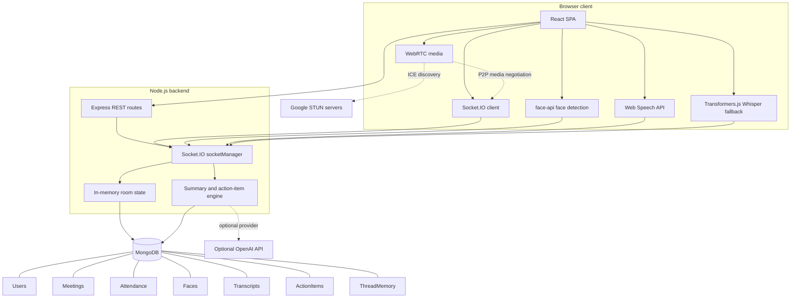
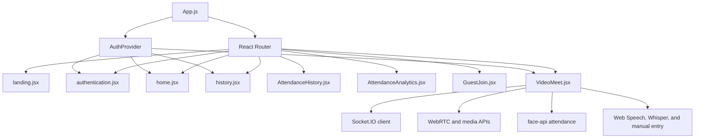
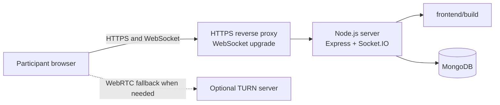
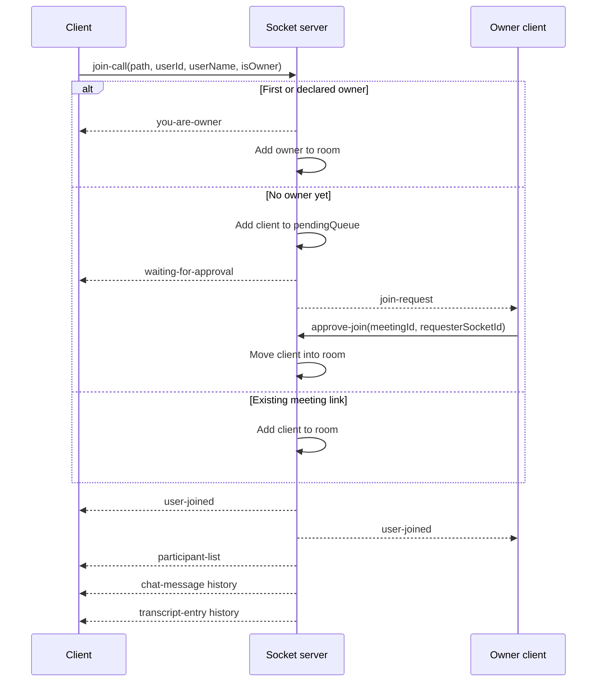
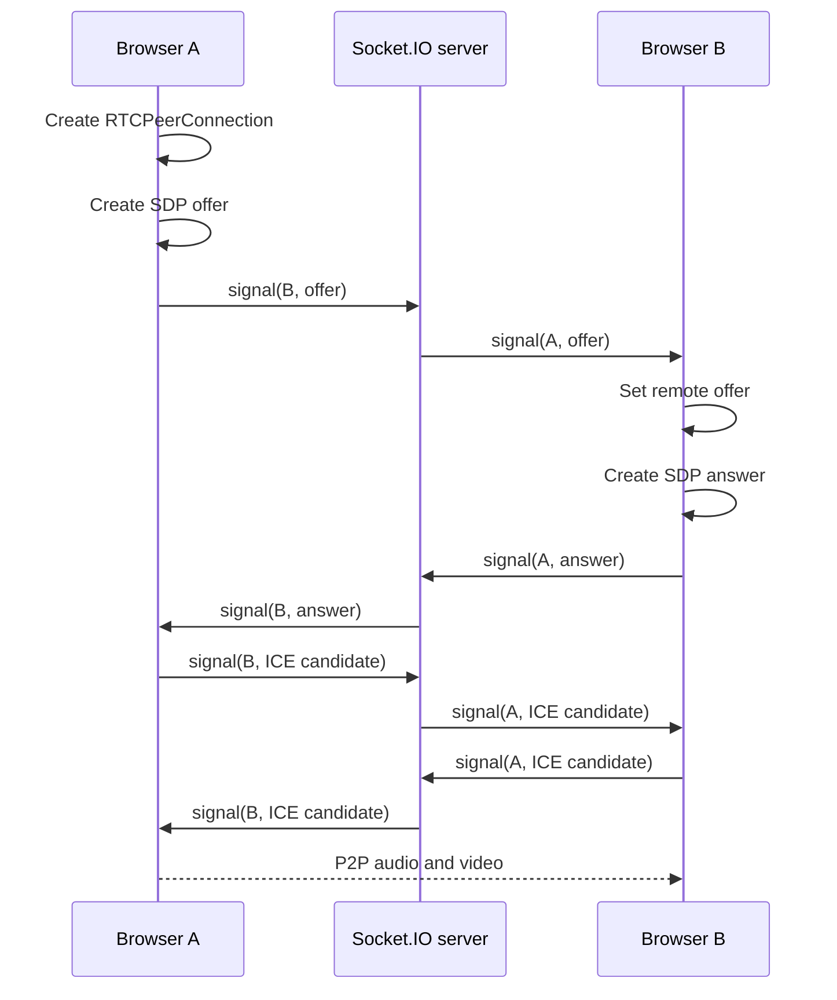
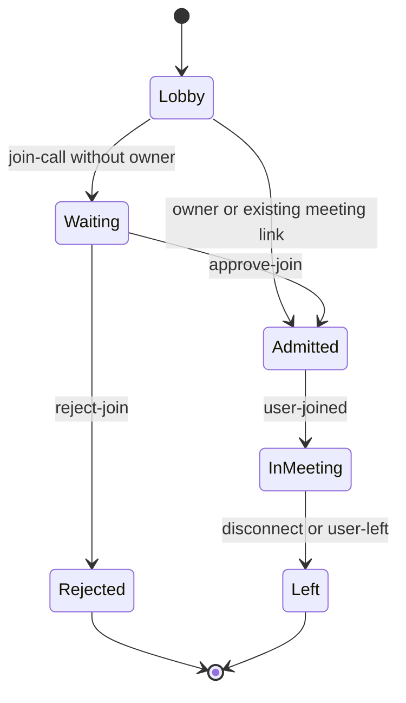
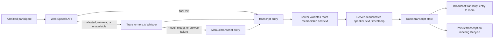
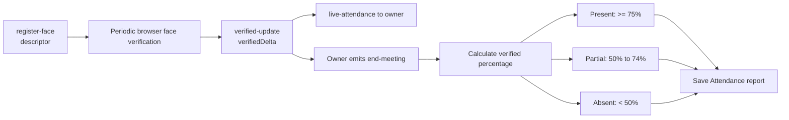
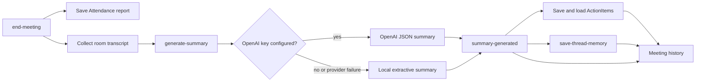
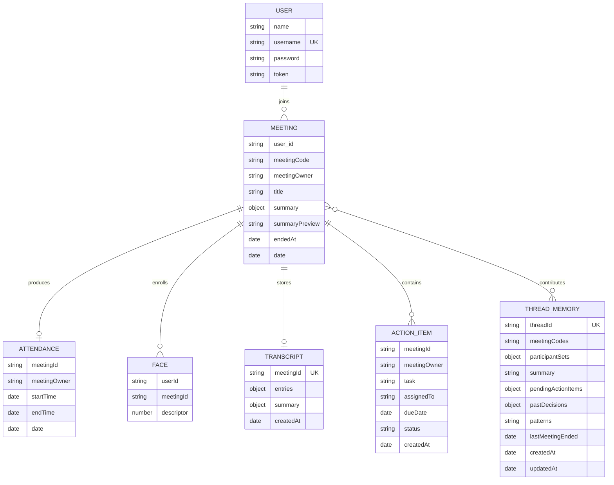

<div align="center">

# MeetSync AI

### Collaborative video meetings with browser AI, attendance, and shared meeting memory

[](https://nodejs.org/)
[](https://react.dev/)
[](https://expressjs.com/)
[](https://socket.io/)
[](https://www.mongodb.com/)
[](https://webrtc.org/)
[](backend/package.json)

</div>

MeetSync AI is a full-stack meeting platform built with React, Express, Socket.IO, WebRTC, and MongoDB. It combines peer-to-peer video meetings with waiting-room admission, room collaboration, face-based attendance, browser-local transcription, extractive or optional OpenAI summaries, action items, cross-meeting memory, history, and attendance analytics.

> [!IMPORTANT]
> Speech recognition is performed in each participant's browser. The backend receives transcript text, then validates, deduplicates, broadcasts, and persists it; it does not currently receive or centrally transcribe a mixed meeting audio stream.

## 📚 Table of Contents

- [✨ Features](#-features)
- [🖼️ Screenshots](#️-screenshots)
- [🏗️ System Architecture](#️-system-architecture)
- [🔄 How It Works](#-how-it-works)
- [🎤 Transcription Design](#-transcription-design)
- [🧑‍💻 Attendance Design](#-attendance-design)
- [🧠 AI Summary, Action Items and Thread Memory](#-ai-summary-action-items-and-thread-memory)
- [🗃️ Data Models](#️-data-models)
- [🧰 Tech Stack](#-tech-stack)
- [🗂️ Project Structure](#️-project-structure)
- [🧭 Frontend Routes](#-frontend-routes)
- [🌐 REST API Reference](#-rest-api-reference)
- [🔌 Socket.IO Events Reference](#-socketio-events-reference)
- [🚀 Getting Started](#-getting-started)
- [🧪 Testing](#-testing)
- [☁️ Production Deployment](#️-production-deployment)
- [🛠️ Troubleshooting](#️-troubleshooting)
- [🔐 Known Limitations, Security and Privacy](#-known-limitations-security-and-privacy)
- [🗺️ Roadmap](#️-roadmap)
- [🤝 Contributing](#-contributing)
- [📄 License](#-license)

## ✨ Features

| Area | Included behavior |
|---|---|
| Video meetings | Peer-to-peer camera and microphone meetings using WebRTC |
| Admission | Meeting owner assignment, waiting room, approval and rejection |
| Collaboration | Room chat, polls, voting, decisions, reactions, hand raising, and screen-share state |
| Attendance | Face enrollment, periodic browser verification, live owner updates, and final attendance reports |
| Transcription | Web Speech API, Transformers.js Whisper fallback, manual entry, room-wide transcript broadcast, replay, and persistence |
| Meeting intelligence | Extractive summaries, optional OpenAI summaries, decisions, risks, next steps, and action items |
| Thread memory | Cross-meeting summaries, pending actions, decisions, participant sets, and previous-meeting context |
| History and analytics | Meeting history, transcript retrieval, attendance history, and Recharts analytics |

## 🖼️ Screenshots

The following paths are placeholders for screenshots that can be added later.

| Screen | Placeholder |
|---|---|
| Landing page | `docs/screenshots/landing-page.png` |
| Meeting room | `docs/screenshots/meeting-room.png` |
| Transcript and summary | `docs/screenshots/transcript-summary.png` |
| Attendance analytics | `docs/screenshots/attendance-analytics.png` |

> [!NOTE]
> The screenshot paths above are documentation placeholders; the image files are not currently included in the repository.

## 🏗️ System Architecture

### High-level architecture



This diagram shows browser responsibilities, real-time and REST boundaries, active room state, persistence, optional OpenAI summaries, and STUN-assisted WebRTC discovery.

### Frontend module relationships



This diagram shows the React entrypoint, global authentication context, route-level pages, and the central meeting component.

### Deployment topology



This diagram shows the provider-neutral production topology and the optional TURN dependency needed by restrictive networks.

## 🔄 How It Works

### Join meeting and admission flow



This sequence shows owner selection, pending users, approval, room admission, participant updates, and late-join history replay.

### WebRTC signaling



This sequence shows the backend relaying SDP and ICE messages while media is intended to flow directly between browsers.

### Participant status



This state diagram describes the participant lifecycle from the pre-join lobby through admission, active participation, rejection, or departure.

## 🎤 Transcription Design

### Pipeline



This pipeline shows local recognition and fallback paths before the server validates, deduplicates, broadcasts, and persists transcript text.

### Behavior and boundaries

- Transcription starts after an admitted participant receives the room's `user-joined` flow.
- Web Speech recognition is continuous and accepts final results that pass the component's confidence handling.
- An unexpected Web Speech interruption switches to the local Transformers.js fallback instead of repeatedly restarting the same recognition instance.
- The fallback uses `MediaRecorder`, `AudioContext`, and `Xenova/whisper-tiny.en`.
- Manual entry remains available when both recognition paths fail.
- The server rejects entries from sockets that are not members of the requested meeting room.
- Late joiners receive the current in-memory transcript history.
- The sender receives the same room broadcast as other participants; the client removes duplicate echoes.

> [!WARNING]
> Browser support, microphone permissions, secure-context rules, speech-service availability, model download size, and device audio configuration can all affect transcription. This architecture cannot guarantee recognition on every browser or device.

## 🧑‍💻 Attendance Design



This flow shows face enrollment, periodic verification, live owner updates, final thresholds, and MongoDB attendance persistence.

The browser uses `@vladmandic/face-api` to detect a face and compare it with an enrolled descriptor. The server tracks total and verified time for active room participants. At meeting end, only the meeting owner can request the final report.

## 🧠 AI Summary, Action Items and Thread Memory



This flow shows how meeting end and explicit summary generation produce attendance, summary, action-item, thread-memory, and history data.

The summary shape includes:

- `executiveSummary`
- `keyDiscussionPoints`
- `decisionsTaken`
- `actionItems`
- `risks`
- `nextSteps`

When `OPENAI_API_KEY` is usable, the server requests structured JSON from `gpt-3.5-turbo`. Otherwise, or when the provider request fails, the server uses its local keyword and sentence-scoring extraction.

## 🗃️ Data Models

### Entity relationships



This ER diagram summarizes the Mongoose collections and the application-level relationships formed through meeting codes, usernames, and thread IDs.

| Model | Important fields | Purpose |
|---|---|---|
| `User` | `name`, unique `username`, bcrypt `password`, `token` | Login account and session token storage |
| `Meeting` | `meetingCode`, owner, participants, summary, dates | Meeting history and summary |
| `Attendance` | meeting owner, participant timing, verified percentage, status | Final attendance report |
| `Face` | user ID, meeting ID, numeric descriptor | Per-meeting face enrollment |
| `Transcript` | unique meeting ID, entries, optional summary | Persisted transcript |
| `ActionItem` | meeting ID, task, assignee, due date, status | Pending/completed meeting tasks |
| `ThreadMemory` | thread ID, meeting codes, participant sets, decisions, patterns | Cross-meeting context |

Active rooms, messages, polls, decisions, waiting users, raised hands, and transcripts are also held in process memory by `socketManager.js` while a server process is running.

## 🧰 Tech Stack

| Layer | Technologies |
|---|---|
| Frontend | React 18, React Router 6, Material UI, Emotion, Framer Motion |
| Realtime | Socket.IO client/server, WebRTC |
| Backend | Node.js ES modules, Express 4 |
| Persistence | MongoDB with Mongoose 8 |
| Attendance | `@vladmandic/face-api`, TensorFlow.js |
| Transcription | Web Speech API, `MediaRecorder`, `AudioContext`, Transformers.js Whisper |
| Charts | Recharts |
| HTTP | Axios |
| AI provider | OpenAI SDK, optional |
| Testing | Jest, Supertest, Testing Library |
| Development | Nodemon, Create React App |

## 🗂️ Project Structure

```text
MeetSync-AI/
├── backend/
│   ├── src/
│   │   ├── __tests__/
│   │   ├── controllers/
│   │   │   ├── socketManager.js
│   │   │   └── user.controller.js
│   │   ├── models/
│   │   ├── routes/
│   │   └── app.js
│   ├── package.json
│   └── jest.config.mjs
├── frontend/
│   ├── public/
│   ├── src/
│   │   ├── components/
│   │   ├── contexts/
│   │   ├── pages/
│   │   ├── styles/
│   │   ├── utils/
│   │   ├── App.js
│   │   └── environment.js
│   └── package.json
├── start-all.js
├── package.json
└── README.md
```

Runtime recordings under `backend/uploads/recordings/`, dependency directories, and build output are not source modules.

## 🧭 Frontend Routes

Routes are defined in [`frontend/src/App.js`](frontend/src/App.js).

| Route | Component | Access and purpose |
|---|---|---|
| `/` | `LandingPage` | Public landing page |
| `/auth` | `Authentication` | Login and registration |
| `/home` | `HomeComponent` | Dashboard for creating and joining meetings |
| `/history` | `History` | Authenticated meeting history |
| `/attendance-history` | `AttendanceHistory` | Attendance records |
| `/attendance-analytics` | `AttendanceAnalytics` | Attendance charts and analysis |
| `/join` | `GuestJoin` | Public meeting-code or URL join flow |
| `/:url` | `VideoMeetComponent` | Dynamic meeting room |

The dynamic route is declared after the more specific routes so it does not consume `/home`, `/history`, or other named pages.

## 🌐 REST API Reference

The backend mounts these routes in [`backend/src/app.js`](backend/src/app.js). `Auth` below describes the authorization behavior implemented by the route, not a future policy.

### Health and users

| Method | Path | Auth | Purpose |
|---|---|---|---|
| `GET` | `/api/health` | None | Return server health and configured port |
| `POST` | `/api/v1/users/register` | None | Create a bcrypt-hashed user account |
| `POST` | `/api/v1/users/login` | None | Validate credentials and create a session token |
| `GET` | `/api/v1/users/get_all_activity` | Token | Return meetings associated with the token's user |
| `POST` | `/api/v1/users/add_to_activity` | Token in body | Add or update a meeting-history record |
| `GET` | `/api/v1/users/meeting/:meetingCode` | Token | Return an authorized meeting, summary, and transcript |

<details>
<summary>Attendance and transcript routes</summary>

| Method | Path | Auth | Purpose |
|---|---|---|---|
| `GET` | `/api/v1/attendance/owner/:userId` | None in route | List up to 50 reports matching the owner query |
| `GET` | `/api/v1/attendance/meeting/:meetingId` | None in route | Return the latest report for a meeting |
| `GET` | `/api/v1/attendance/user/:userId` | None in route | Return participant-specific attendance data |
| `GET` | `/api/v1/attendance/transcript/:meetingId` | None in route | Return a persisted transcript |

</details>

<details>
<summary>Action-item and thread-memory routes</summary>

| Method | Path | Auth | Purpose |
|---|---|---|---|
| `GET` | `/api/v1/action-items/meeting/:meetingId` | None in route | List action items for a meeting |
| `PATCH` | `/api/v1/action-items/:id/toggle` | None in route | Toggle `pending` and `completed` |
| `GET` | `/api/v1/memory/thread/:meetingCode` | None in route | Return matching thread-memory context |

</details>

> [!WARNING]
> Attendance, action-item, and thread-memory REST routes currently do not perform a token or ownership check. Add authorization middleware before exposing these routes to untrusted users.

## 🔌 Socket.IO Events Reference

The Socket.IO server is configured in [`backend/src/controllers/socketManager.js`](backend/src/controllers/socketManager.js). Direction is relative to the browser client.

### Room admission and WebRTC

| Event | Direction | Purpose |
|---|---|---|
| `join-call` | Client → server | Request admission with meeting path, user ID, name, and owner flag |
| `you-are-owner` | Server → client | Confirm owner assignment |
| `waiting-for-approval` | Server → client | Tell a participant to wait |
| `join-request` | Server → owner | Notify the owner about a pending participant |
| `approve-join` | Client → server | Admit a waiting socket |
| `reject-join` | Client → server | Reject a waiting socket |
| `join-rejected` | Server → client | Notify the rejected participant |
| `user-joined` | Server → room member | Share a joined socket ID and client list |
| `user-left` | Server → room | Notify clients that a socket left |
| `participant-list` | Server → room | Broadcast participant metadata |
| `signal` | Client ↔ server | Relay SDP and ICE payloads |

<details>
<summary>Collaboration and screen-share events</summary>

| Event | Direction | Purpose |
|---|---|---|
| `chat-message` | Client ↔ server | Send and replay room chat |
| `create-poll` | Client → server | Create a poll |
| `poll-created` | Server → room | Broadcast a new poll |
| `vote-poll` | Client → server | Vote for an option |
| `poll-updated` | Server → room | Broadcast updated votes |
| `add-decision` | Client → server | Add a decision |
| `decision-added` | Server → room | Broadcast a decision |
| `send-reaction` | Client → server | Send a reaction |
| `reaction-received` | Server → room | Broadcast a reaction |
| `raise-hand` | Client → server | Set a participant's raised-hand state |
| `hand-raise-update` | Server → room | Broadcast raised hands |
| `screen-share-started` | Client → server / server → room | Announce screen sharing |
| `screen-share-stopped` | Client → server / server → room | Announce its end |

</details>

<details>
<summary>Attendance events</summary>

| Event | Direction | Purpose |
|---|---|---|
| `register-face` | Client → server | Store a face descriptor for a meeting |
| `face-registered` | Server → client | Confirm descriptor storage |
| `verified-update` | Client → server | Report verified attendance delta |
| `live-attendance` | Server → owner | Send live participant timing |
| `end-meeting` | Client → server | Owner-only finalization request |
| `attendance-report` | Server → room | Broadcast final report |
| `owner-attendance-report` | Server → owner | Send owner report |

</details>

<details>
<summary>Transcription, summary, action-item, and memory events</summary>

| Event | Direction | Purpose |
|---|---|---|
| `transcript-entry` | Client ↔ server | Validate, deduplicate, store, replay, and broadcast text |
| `generate-summary` | Client → server | Request a merged transcript summary |
| `summary-generated` | Server → room | Broadcast summary result |
| `get-action-items` | Client → server | Request persisted action items |
| `action-items-list` | Server → client | Return action items |
| `toggle-action-item` | Client → server | Toggle an action item |
| `action-item-updated` | Server → room | Broadcast item changes |
| `save-thread-memory` | Client → server | Save cross-meeting context |
| `get-thread-memory` | Client → server | Request thread memory |
| `thread-memory-result` | Server → client | Return thread memory |
| `get-meeting-context` | Client → server | Request previous meeting context |
| `meeting-context-result` | Server → client | Return previous meeting context |

</details>

## 🚀 Getting Started

### Prerequisites

- Node.js 18 or newer
- npm
- MongoDB
- A modern browser with WebRTC support
- HTTPS for deployed camera and microphone access

### Install

From the repository root:

```powershell
cd backend
npm install
cd ..\frontend
npm install
cd ..
```

### Configure the backend

Create `backend/.env`:

```env
PORT=8000
MONGO_URI=mongodb://127.0.0.1:27017/meetsync
OPENAI_API_KEY=your_openai_api_key_here
FRONTEND_URL=http://localhost:3000
NODE_ENV=development
```

`OPENAI_API_KEY` is optional. Leave it unset or use the placeholder to use the local summary path.

### Configure the frontend

Create `frontend/.env`:

```env
REACT_APP_BACKEND_URL=http://localhost:8000
```

The shared frontend environment module defaults to `http://localhost:8000` when this variable is absent.

### Run the backend

```powershell
cd backend
npm run dev
```

### Run the frontend

In a second terminal:

```powershell
cd frontend
npm start
```

Open `http://localhost:3000`.

### Run both applications

From the repository root:

```powershell
node start-all.js
```

The launcher cleans ports `8000` and `3000`, starts `backend` with `npm run dev`, starts `frontend` with `npm start`, and opens the browser after startup.

## 🧪 Testing

### Frontend tests

```powershell
cd frontend
npx react-scripts test --watchAll=false --runInBand
```

### Frontend production build

```powershell
cd frontend
npm run build
```

### Backend tests

```powershell
cd backend
node --experimental-vm-modules node_modules/jest/bin/jest.js --runInBand
```

The backend test suite covers health, authentication/history, attendance, action items, summary extraction, Socket.IO admission/signaling, collaboration, and transcript behavior. Frontend tests cover routes, auth context, meeting interactions, attendance pages, guest joining, transcription lifecycle/fallback, and analytics.

## ☁️ Production Deployment

The backend serves the compiled React application when `NODE_ENV=production`.

1. Provision Node.js and MongoDB.
2. Install backend and frontend dependencies.
3. Configure the environment variables below using the hosting platform's secret manager.
4. Build the frontend.
5. Start the backend over HTTPS behind a reverse proxy.
6. Configure the proxy to support WebSocket upgrades.
7. Restrict CORS to the deployed frontend origin.
8. Add TURN infrastructure if peer-to-peer connections must work through restrictive NATs.

Build and start:

```powershell
cd frontend
npm run build
cd ..\backend
npm start
```

| Variable | Required | Purpose |
|---|---|---|
| `PORT` | No | Backend port; defaults to `8000` |
| `MONGO_URI` | Yes | MongoDB connection string |
| `OPENAI_API_KEY` | No | Enables OpenAI summary generation |
| `FRONTEND_URL` | Recommended | Adds the deployed frontend origin to CORS configuration |
| `REACT_APP_BACKEND_URL` | Recommended | Frontend build-time backend URL |
| `NODE_ENV` | For production serving | Set to `production` to serve `frontend/build` |

> [!IMPORTANT]
> Camera, microphone, WebRTC, and Socket.IO deployment require HTTPS and a proxy that preserves WebSocket upgrades. The current client config includes Google STUN servers but no TURN server.

## 🛠️ Troubleshooting

<details>
<summary>Camera or microphone access fails</summary>

- Use `http://localhost` locally or HTTPS in a deployed environment.
- Check browser permission settings.
- Confirm another application is not using the device.
- Reload after changing permissions.
- The meeting client can attempt video-only access when full media access fails.

</details>

<details>
<summary>Transcription stops or is unavailable</summary>

- Use a browser with Web Speech support for the primary path.
- Confirm microphone permission.
- Check the browser secure context.
- Wait for the approximately 70 MB local Whisper model to load.
- Use manual transcript entry if both local recognition paths fail.

The repeated Web Speech restart loop is intentionally not used; an interruption causes a controlled switch to the fallback path.

</details>

<details>
<summary>Participants cannot connect</summary>

- Confirm both clients can reach `REACT_APP_BACKEND_URL`.
- Confirm the backend is listening on port `8000` or the configured `PORT`.
- Verify WebSocket upgrades through the reverse proxy.
- Check browser console logs for SDP and ICE errors.
- Consider adding a TURN server for restrictive networks.

</details>

<details>
<summary>The backend does not start</summary>

- Verify `MONGO_URI` is set and reachable.
- Check whether the configured port is already in use.
- Start from the `backend` directory.
- Confirm Node.js and npm versions.
- Inspect the startup error before changing source code.

</details>

<details>
<summary>An API route returns 401, 403, or 404</summary>

- Use the exact `/api/v1/...` prefix.
- Send the login token as the `Authorization` header where the route requires it.
- `add_to_activity` currently expects the token in the request body.
- Confirm the meeting code exists and the authenticated user belongs to it.
- Remember that attendance, action-item, and memory routes currently lack route-level auth checks.

</details>

## 🔐 Known Limitations, Security and Privacy

> [!WARNING]
> The current CORS callback logs blocked origins but allows them for debugging. Restrict this behavior before production use.

> [!WARNING]
> The `User` model stores a generated session token in a plain database field and the frontend stores that token in `localStorage`. This is not a replacement for a hardened authentication/session design.

> [!WARNING]
> Attendance, action-item, and thread-memory REST endpoints do not currently verify the caller's identity or ownership. Treat them as development-stage APIs until authorization middleware is added.

> [!NOTE]
> Active room state is process-local. A restart loses unpersisted room messages, participant state, polls, decisions, and transcript state. Multiple backend instances would need shared Socket.IO state and coordinated persistence.

Additional limitations:

- Browser-local speech recognition depends on browser APIs, permissions, speech services, and model resources.
- The application has no configured TURN server, so some NAT and firewall environments will prevent P2P media.
- Face enrollment and verification require camera access, suitable lighting, and a detectable face.
- Face descriptors, transcripts, meeting history, and attendance are sensitive data.
- Optional OpenAI summaries transmit merged transcript text to the configured provider.
- Authentication is token-based but does not yet provide a complete middleware layer across all routes and sockets.
- HTTPS is required for secure deployed media and realtime traffic.

## 🗺️ Roadmap

These are realistic follow-up improvements, not claims about current functionality:

- Add a managed TURN server and configurable ICE server environment variables.
- Add server-side or hosted transcription for browser-independent capture.
- Replace localStorage session tokens with hardened JWT or secure cookie sessions.
- Add authentication and ownership middleware to every REST and sensitive Socket.IO operation.
- Add a Socket.IO Redis adapter and shared state for horizontal scaling.
- Add retention controls, encryption policies, and explicit consent flows for transcripts and face descriptors.
- Add automated browser-level meeting tests across supported browsers.

## 🤝 Contributing

1. Create a focused branch.
2. Keep changes scoped to the feature or fix.
3. Update tests and documentation when behavior changes.
4. Run the relevant frontend tests, backend tests, and production build.
5. Do not commit `.env` files, API keys, recordings, model caches, or personal meeting data.
6. Open a pull request describing behavior, validation, and any deployment implications.

## 📄 License

The backend package declares the ISC license. Review the package metadata and repository terms before redistributing or deploying the project.
